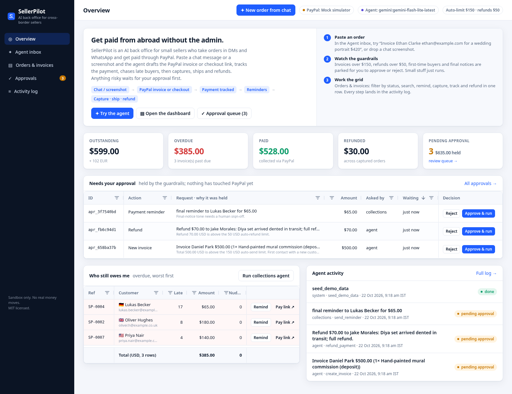
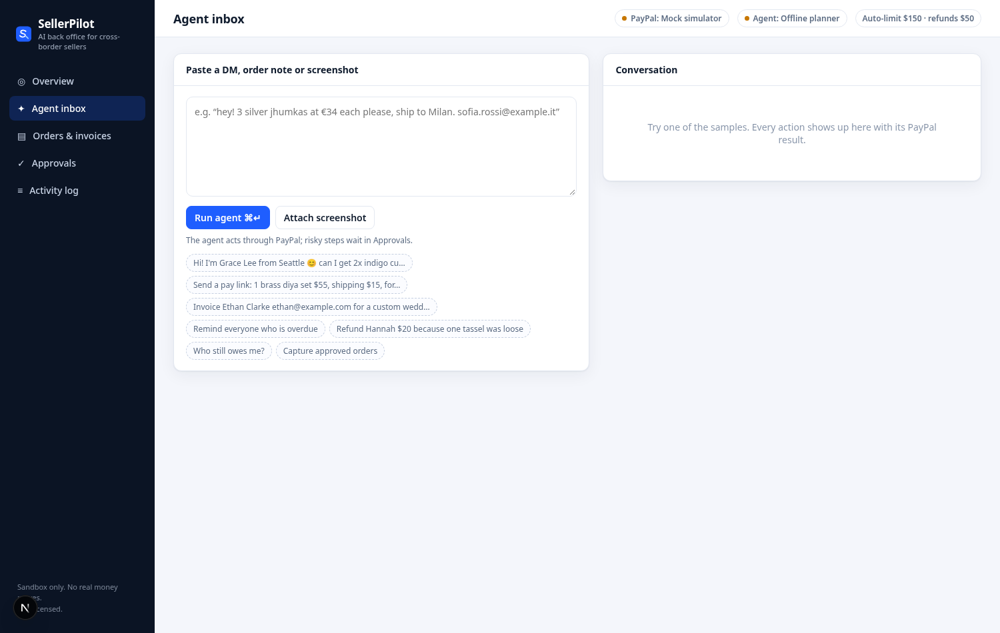
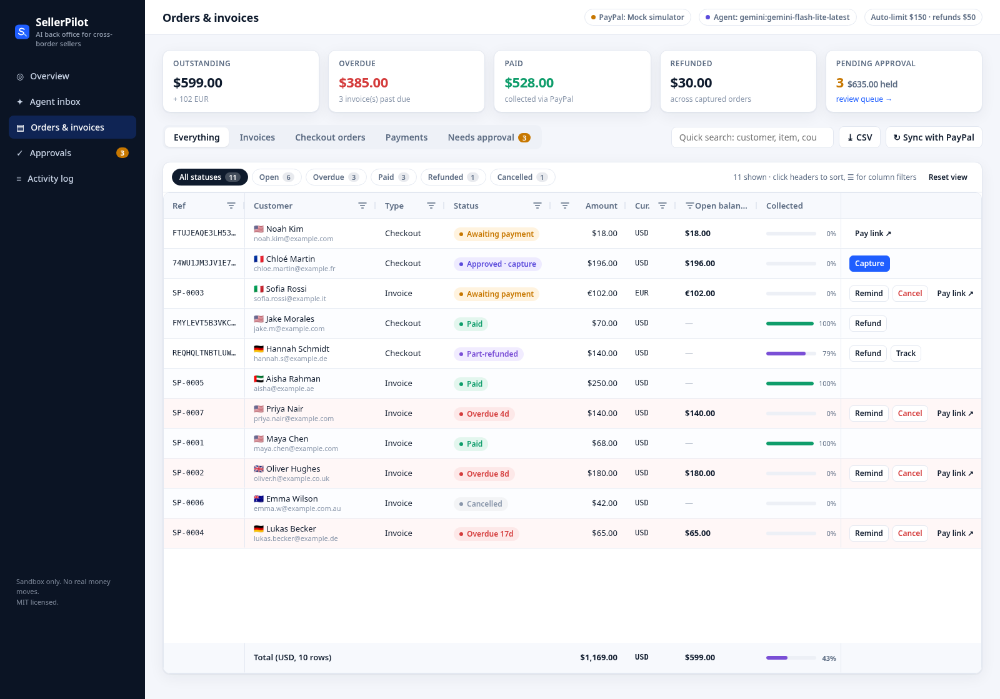
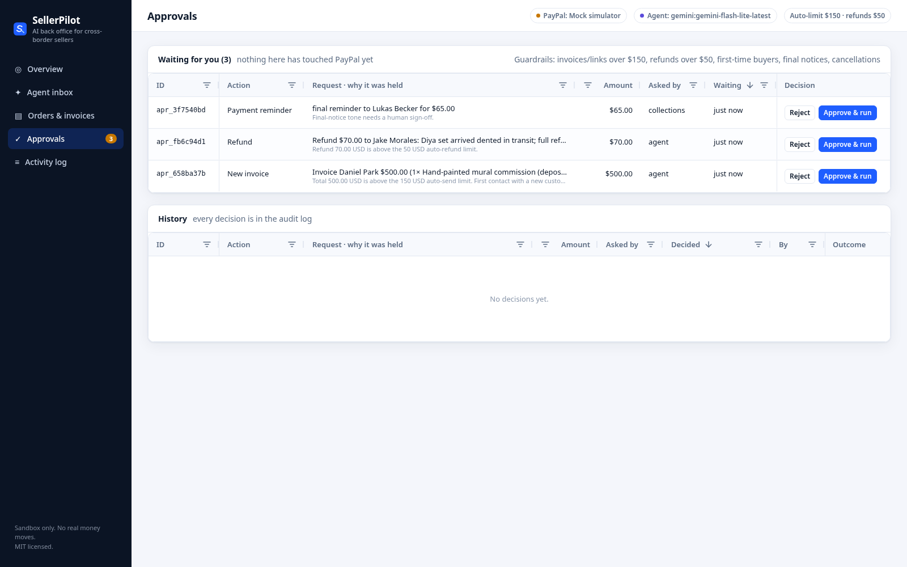
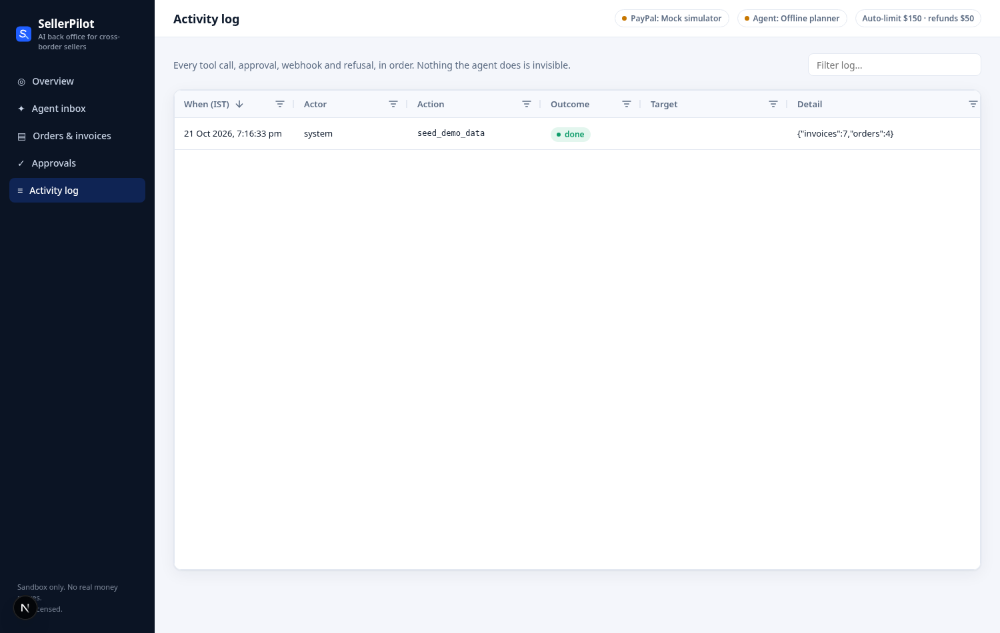
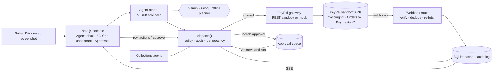

# SellerPilot

**An AI back office for small sellers who take orders in chat and get paid from abroad through PayPal.**

Paste a customer's DM, order note or screenshot. SellerPilot turns it into a PayPal invoice or checkout link, watches for payment through webhooks, chases late payers, captures approved orders, adds tracking and handles refunds. Anything risky waits for the seller's OK, and every step is logged.

Built for the PayPal AI Hackathon (2026). PayPal **sandbox only**; no real money moves.

- **Run it in 2 commands, no keys:** `npm install && npm run dev` (mock PayPal + offline agent, see [Quick start](#quick-start-mock-mode-no-keys))
- **Run it against the real PayPal sandbox:** add sandbox REST credentials and a free Gemini key (see [Live sandbox mode](#live-sandbox-mode))
- Demo video: _YouTube link added on the Devpost page_ · License: [MIT](LICENSE)



## The problem

An Indian block-print studio sells to a buyer in Seattle over Instagram. The order arrives as a chat message. Then comes a manual loop: typing up an invoice, sending a pay link, checking whether it was paid, nudging politely, then less politely, adding tracking, and handling a refund for a loose tassel. SellerPilot runs that loop on PayPal's APIs, and the seller stays in charge of anything that moves real money.

## What it does

| You say / do | SellerPilot does (PayPal API) |
|---|---|
| Paste "Hi! I'm Grace from Seattle, 2× indigo cushion covers at $28 + $12 shipping, grace@…" | Parses items, prices, currency and buyer. Creates and sends an invoice (Invoicing v2 `POST /v2/invoicing/invoices` → `/send`) |
| "Send a pay link: 1 brass diya set $55…" | Creates a checkout order (Orders v2 `POST /v2/checkout/orders`) and returns the buyer's approval link |
| Buyer approves the checkout | Webhook `CHECKOUT.ORDER.APPROVED` is verified and the order is captured (`/capture`) |
| "Remind everyone who is overdue" / the collections agent tick | Sends friendly, firm or final reminders (`/remind`) by days overdue, at most 2 a day. Final notices need approval |
| "Refund Hannah $20, one tassel was loose" | Partial refund on the capture (Payments v2 `/v2/payments/captures/{id}/refund`), with approval above the limit |
| Add tracking | `POST /v2/checkout/orders/{id}/track` |
| "Who still owes me?" | Answers from the synced ledger |

**Guardrails** (`lib/agent/policies.ts`). Each action goes through a single `dispatch()` that applies policy, writes to the audit log, emits live events and sets idempotency keys:
- *Deny*: INR (PayPal India accounts can't receive INR; sellers bill abroad in USD etc. per PayPal's currency-codes page), a hard $10k ceiling, empty or zero orders, reminders on invoices that aren't awaiting payment, more than 2 reminders a day, capturing an unapproved order, refunding more than was captured, and tracking without a completed capture.
- *Needs approval*: amounts over `APPROVAL_THRESHOLD_USD`, non-USD currencies, first contact with a new customer, final-tone reminders, refunds over `REFUND_AUTO_LIMIT_USD`, and every cancellation.

**Dashboard.** Built on AG Grid Community (no Enterprise licence): a KPI strip (outstanding, overdue, paid, refunded, pending approval with the dollar amount held), an orders, invoices and payments grid with status badges, open balance per row, status filter chips with counts, quick search, column filters, CSV export, a pinned totals row that follows whatever is filtered, and row actions (remind, capture, track, refund, cancel) wired to the same action layer the agent uses. The approval queue is its own grid with Approve & run / Reject per row, shown on the overview, on the dashboard's "Needs approval" tab and on /approvals. Live cell flashes come from server-sent events, and the activity log is a grid too. A later milestone adds an AG Studio analytics dashboard (the seam is `components/grid/RecordsGrid.tsx` plus `/api/records`).

## How PayPal is used

| PayPal API | Used for | Code |
|---|---|---|
| OAuth 2.0 (`POST /v1/oauth2/token`, client credentials) | Token cache with early refresh | `lib/paypal/client.ts` |
| **Invoicing v2** (`/v2/invoicing/invoices`, `/send`, `/remind`, `/cancel`, search) | DM → invoice, reminders, cancellations, sync | `lib/paypal/rest.ts`, `builders.ts` |
| **Orders v2** (`/v2/checkout/orders`, `/capture`, `/track`) | Pay links, auto-capture after buyer approval, shipment tracking | `lib/paypal/rest.ts` |
| **Payments v2** (`/v2/payments/captures/{id}/refund`) | Full and partial refunds | `lib/paypal/rest.ts` |
| **Webhooks** (`/v1/notifications/verify-webhook-signature`) | `INVOICING.INVOICE.PAID`, `CHECKOUT.ORDER.APPROVED`, `PAYMENT.CAPTURE.*`: verify → dedupe by event id → re-fetch from PayPal → upsert | `app/api/paypal/webhook`, `lib/sync.ts` |

Every POST carries a `PayPal-Request-Id` (the capture key is derived from the order id), so retries and double-clicks cannot double-charge. Live (production) PayPal URLs are refused by config.

## How AI is used

- **Tool-calling agent** (Vercel AI SDK `ai` v7). The model reads the seller's message and calls typed zod tools (`lib/agent/tools.ts`): `create_invoice`, `create_checkout`, `send_reminder`, `capture_order`, `refund_payment`, `add_tracking`, `cancel_invoice`, plus read-only `list_records` and `business_summary`. It runs multi-step, so it can look a customer up, then act.
- **Vision.** A screenshot of an order (PNG/JPEG/WebP) can be attached in the Agent inbox; the Gemini path reads it like a typed message.
- **The model proposes, policy decides.** Every tool call goes through one server-side `dispatch()` (`lib/actions.ts`) that applies the guardrails in `lib/agent/policies.ts` whatever the model says. The model never sees credentials and has no direct PayPal access.
- **Collections agent.** Picks a friendly, firm or final tone from days overdue; final notices need approval. Run it from the overview or `POST /api/cron/collections`.
- **Providers.** Gemini (free AI Studio key, default model `gemini-flash-lite-latest`), Groq (OpenAI-compatible), or an **offline rule-based planner** that needs no key. If the LLM errors or hits a rate limit, the agent falls back to the offline planner so the demo never dies.

## AG Grid dashboard

Built on **AG Grid Community v36** (no Enterprise licence):
- KPI strip: collected, outstanding, overdue, refunded, and dollars held for approval
- Orders / invoices / checkout / payments grid with status badges, open balance per row, status filter chips with counts, quick search, column filters, CSV export and a **pinned totals row that follows the filter**
- Row actions (remind, capture, track, refund, cancel, open pay link) wired to the same `dispatch()` the agent uses
- Approval queue grid with **Approve & run / Reject**, live cell flashes over server-sent events, and the activity log as a grid

| Agent inbox | Orders grid | Approval queue | Activity log |
|---|---|---|---|
|  |  |  |  |

## Architecture



### Code map

```
app/(console)/*          seller console: overview, agent inbox, orders, approvals, activity
app/mock-paypal/*        simulated buyer pages (mock mode only)
app/api/*                route handlers (agent, actions, approvals, webhook, sync, SSE events, cron)
lib/paypal/              client (OAuth cache, retries, PayPal-Request-Id), REST gateway, mock gateway,
                         request builders, normalizers, webhook parsing + verification
lib/agent/               provider switch (Gemini / Groq / offline), tools, prompts, policies, runner
lib/actions.ts           the one dispatch() choke point + approval decisions
lib/sync.ts              PayPal-is-truth: webhook → dedupe → re-fetch → upsert
lib/collections.ts       reminder tone planning + runner
lib/db/                  SQLite (better-sqlite3): records, approvals, audit_log, webhook_events, agent_runs
components/grid/         AG Grid theme, renderers, RecordsGrid
tests/                   vitest suites
```

Design rules:
1. **PayPal is the source of truth.** The local DB is a cache plus an audit trail. A webhook is verified first and deduplicated by event id, then the resource is re-fetched rather than trusting the payload.
2. **One choke point.** The agent, the UI buttons and the collections job all call `dispatch()`. The model has no direct access to PayPal.
3. **Idempotent by default.** Every POST carries a `PayPal-Request-Id`, and the capture key is derived from the order id, so retries and double-clicks don't double-charge.
4. **The model proposes, policy decides.** Tool calls are validated with zod, and policy runs server-side whatever the model says.

## Quick start (mock mode, no keys)

Requires **Node.js 22.13+** and npm.

```bash
git clone <this repo> sellerpilot && cd sellerpilot
npm install
npm run dev            # open http://localhost:3000
```

With no `.env`, PayPal runs in **mock mode** and the agent uses the **offline planner**. The mock follows the documented PayPal state machines and serves stand-in buyer pages (`/mock-paypal/...`); clicking "Approve & pay" there emits the same webhook events PayPal would, through the real webhook pipeline. Demo data (11 records and 3 requests held by the guardrails) is seeded on first start.

Things to try in the **Agent inbox** (sample buttons are on the page):
1. `Hi! I'm Grace Lee from Seattle, can I get 2x indigo cushion covers @ $28 each + shipping $12? email grace.lee@example.com` → invoice held for approval (first contact). Approve it in **Approvals**.
2. `Send a pay link: 1 brass diya set $55, shipping $15, for Jake Morales` → open the link, approve as the simulated buyer, and the order is auto-captured.
3. `Refund Jake Morales $20 because the box arrived dented` → refunded (under the $50 auto limit).
4. `Who still owes me?` / `Remind everyone who is overdue`.

Production build: `npm run build && npm start`.

## Live sandbox mode

1. At [developer.paypal.com](https://developer.paypal.com) → Apps & Credentials (Sandbox), create a REST app tied to a **US sandbox business account** (sandbox accounts from India can't receive payments). Note the sandbox personal (buyer) account for paying invoices.
2. Get a free Gemini API key at [aistudio.google.com/apikey](https://aistudio.google.com/apikey) (no billing, no card).
3. `cp .env.example .env` and set:

| Variable | Value |
|---|---|
| `PAYPAL_MODE` | `sandbox` |
| `PAYPAL_CLIENT_ID`, `PAYPAL_CLIENT_SECRET` | from your sandbox REST app |
| `PAYPAL_INVOICER_EMAIL` | the sandbox business account email |
| `LLM_PROVIDER` | `gemini` (or `groq` with `GROQ_API_KEY`, or `offline`) |
| `GEMINI_API_KEY` | your AI Studio key |
| `GEMINI_MODEL` | `gemini-flash-lite-latest` (new keys get 404 on `gemini-2.5-flash`; newer flash models are often rate-limited on the free tier) |
| `PAYPAL_WEBHOOK_ID` | optional: needs a public HTTPS URL pointing at `/api/paypal/webhook` |
| `CRON_SECRET` | Bearer token for `POST /api/cron/collections` |

4. `npm run dev`. Then:
   - `npm run smoke`: drives the real REST gateway against `api-m.sandbox.paypal.com` (token, invoice create/send/remind/cancel/search, order create, error shapes, webhook verify endpoint) and writes a redacted report.
   - `npm run agent:demo -- "Invoice Acme Co (billing acme@example.com) $120 for a logo design project, net 15"`: runs the LLM agent end to end against the sandbox.

Guardrail defaults: `APPROVAL_THRESHOLD_USD=150`, `REFUND_AUTO_LIMIT_USD=50`, `APPROVE_FIRST_CONTACT=true`.

## Verified against the live PayPal sandbox (21 Oct 2026)

- `npm run smoke`: **17/17 steps as expected** against `api-m.sandbox.paypal.com` (OAuth, invoice create → send → remind → cancel → search, order create, `ORDER_NOT_APPROVED` and `INVALID_RESOURCE_ID` error handling, webhook-verify endpoint shape).
- `npm run agent:demo` with Gemini `gemini-flash-lite-latest`: the plain-English request "Invoice Acme Co … $120 for a logo design project, net 15" produced a **real sandbox invoice `INV2-72YU-E3CK-E8MZ-229F`**, status `SENT`, USD 120.00, due 2026-11-05, read back independently via GET.
- The same agent asked for a $500 invoice: **the guardrail held it** (`pending_approval`, "Total 500.00 USD is above the 150 USD auto-send limit") and nothing was sent to PayPal.

Details and the recorded response shapes are in [STATUS.md](STATUS.md).

## Tests

```bash
npm test             # vitest: 12 test files, 61 tests (mock PayPal, fake fetch for REST shapes, offline agent)
npm run lint
npm run typecheck
```

## Limitations (honest list)

- **Not yet run live:** buyer approval → capture → tracking → refund, and paying an invoice, on the real sandbox (needs a browser buyer login); these flows are covered in mock mode and by unit tests against PayPal's documented request/response shapes.
- **Webhook signature verification** is implemented and its endpoint was exercised, but no sandbox webhook is registered yet (needs a public HTTPS deployment).
- No hosted demo yet; judges run it locally (zero config).
- Totals are USD-only; non-USD invoices (e.g. EUR) are shown separately, no currency conversion.
- INR is refused on purpose (PayPal India accounts can't receive INR from buyers abroad).
- The offline planner is text-only; screenshot reading needs an LLM key.
- AG Studio analytics (sponsor product) is not integrated yet; the seam is `components/grid/RecordsGrid.tsx` + `/api/records`.

## AI tools used

- Vercel AI SDK (`ai` v7) with `@ai-sdk/google` (Gemini) and `@ai-sdk/openai-compatible` (Groq) for multi-step tool calling.
- The agent's tools are typed zod tools in `lib/agent/tools.ts`. The official `@paypal/agent-toolkit` was evaluated but currently peer-depends on `ai@^4` / `zod@^3`, so the same operations are implemented directly against the REST APIs.
- Development was AI-assisted.

## License

[MIT](LICENSE)
